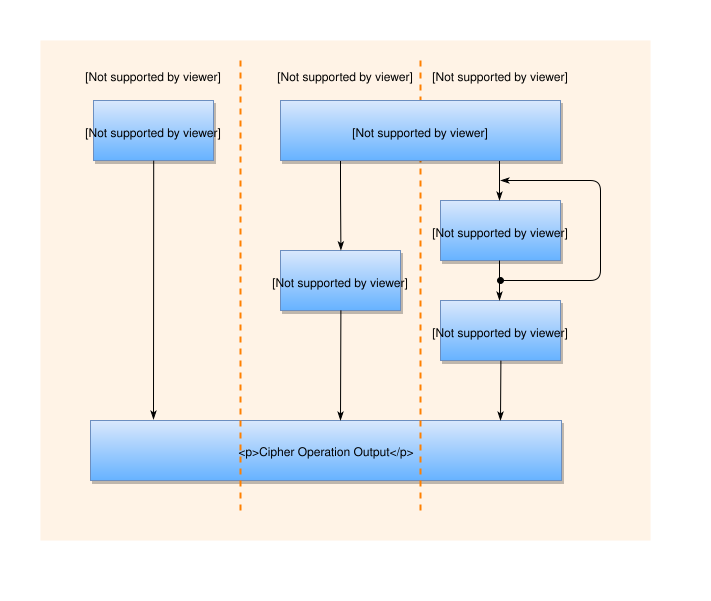

# hpcs-grep11-go

> Go client library for **IBM Cloud Hyper Protect Crypto Services (HPCS)** via the
> **Enterprise PKCS #11 over gRPC (GREP11)** protocol.

[](go.mod)
[](go.mod)

---

## Overview

This repository contains the official IBM Cloud Go SDK for interacting with HPCS
using GREP11. It provides a generated gRPC/protobuf client for all Crypto service
RPCs, IAM bearer-token lifecycle management, helper utilities for key templates and
error handling, and a `crypto.Signer` adapter that lets HSM-backed keys work
transparently in `crypto/tls`.

For full IBM Cloud documentation see:
- [Hyper Protect Crypto Services](https://cloud.ibm.com/docs/hs-crypto?topic=hs-crypto-get-started)
- [GREP11 API reference](https://cloud.ibm.com/docs/hs-crypto?topic=hs-crypto-grep11-api-ref)
- [EP11 cloud HSM overview](https://cloud.ibm.com/docs/hs-crypto?topic=hs-crypto-introduce-cloud-hsm#access-cloud-hsm-pkcs11)

For the full module specification see [`SPEC.md`](SPEC.md).

---

## Architecture

```
 ┌───────────────────────────────────────┐
 │        Your Go Application            │
 └──────────────────┬────────────────────┘
                    │
       ┌────────────▼────────────┐
       │        pkg/util         │
       │  GetCryptoClient()      │
       │  AttributeMap()         │
       │  GetPubKey() / Convert()│
       │  EP11PrivateKey (Signer)│
       └──────┬──────────┬───────┘
              │          │
   ┌──────────▼──┐  ┌────▼──────────┐
   │pkg/authorize│  │   pkg/grpc    │
   │IAMPerRPC    │  │ CryptoClient  │
   │Credentials  │  │ KeyBlob, etc. │
   └──────┬──────┘  └──────┬────────┘
          │ HTTPS           │ gRPC / TLS :443
          ▼                 ▼
    IBM Cloud IAM    IBM Cloud HPCS
    /identity/token  EP11 HSM (CEX7/CEX8)
```

See [`arch_diagram.drawio`](arch_diagram.drawio) for the full interactive diagram
(open with [draw.io](https://app.diagrams.net)).

---

## Requirements

| Requirement | Version |
|---|---|
| Go | **1.27.2** or later |
| IBM Cloud HPCS instance | Any region |
| IBM Cloud API key | With access to the HPCS instance |

> **Note:** This repository uses Go modules. Clone it anywhere — no `GOPATH`
> placement required.

---

## Dependencies

| Module | Version | Purpose |
|---|---|---|
| `google.golang.org/grpc` | `v1.84.0` | gRPC transport |
| `google.golang.org/protobuf` | `v1.36.12` | Protobuf runtime |
| `github.com/golang/protobuf` | `v1.5.4` | Legacy proto wrapper (gogo compat) |
| `github.com/gogo/protobuf` | `v1.3.2` | EP11 proto codegen |
| `github.com/btcsuite/btcd/btcec/v2` | `v2.5.0` | secp256k1 / BIP32 / Schnorr |
| `github.com/Zilliqa/gozilliqa-sdk/v3` | `v3.0.0-20230120` | BIP32 derivation helper |

---

## Packages

| Package | Description |
|---|---|
| [`pkg/util`](pkg/util/) | Core helpers: `GetCryptoClient`, `AttributeMap`, `GetPubKey`, `Convert`, `EP11PrivateKey` |
| [`pkg/authorize`](pkg/authorize/) | IBM Cloud IAM token management (`IAMPerRPCCredentials`) |
| [`pkg/ep11`](pkg/ep11/) | Generated PKCS #11 constants — `CKM_*`, `CKA_*`, `CKR_*` |
| [`pkg/grpc`](pkg/grpc/) | Generated gRPC client & protobuf types |
| [`examples`](examples/) | Runnable examples for every major operation |

---

## Quick Start

### 1. Install Go

[https://golang.org/doc/install](https://golang.org/doc/install)

### 2. Clone

```bash
git clone https://github.com/IBM-Cloud/hpcs-grep11-go.git
cd hpcs-grep11-go
```

### 3. Set environment variables

```bash
# Required — obtain from your HPCS instance page in IBM Cloud
export GREP11_ADDRESS="<instance-id>.ep11.hs-crypto.appdomain.cloud:443"
export GREP11_APIKEY="<your-ibm-cloud-api-key>"

# Optional — override IAM endpoint (default: https://iam.cloud.ibm.com)
export GREP11_IAMENDPOINT="https://iam.cloud.ibm.com"
```

> **Tip:** The `GREP11_ADDRESS` value is on your HPCS instance's main page in the
> IBM Cloud UI under *Enterprise PKCS #11 endpoint URL*. If no port is shown,
> append `:443`.

### 4. Run the examples

```bash
cd examples
go test -v -run Example_keygen_AES
```

To run **all** examples:

```bash
go test -v
```

### 5. Use as a library

```go
import (
    "github.com/IBM-Cloud/hpcs-grep11-go/v2/pkg/util"
    "github.com/IBM-Cloud/hpcs-grep11-go/v2/pkg/ep11"
    pb "github.com/IBM-Cloud/hpcs-grep11-go/v2/pkg/grpc"
    "github.com/IBM-Cloud/hpcs-grep11-go/v2/pkg/authorize"
    "google.golang.org/grpc"
    "google.golang.org/grpc/credentials"
    "crypto/tls"
)

config := &util.ClientConfig{
    Address:     os.Getenv("GREP11_ADDRESS"),
    APIKey:      os.Getenv("GREP11_APIKEY"),
    IAMEndpoint: "https://iam.cloud.ibm.com",
    DialOpts: []grpc.DialOption{
        grpc.WithTransportCredentials(credentials.NewTLS(&tls.Config{})),
        grpc.WithPerRPCCredentials(&authorize.IAMPerRPCCredentials{
            APIKey:   os.Getenv("GREP11_APIKEY"),
            Endpoint: "https://iam.cloud.ibm.com",
        }),
    },
}

cryptoClient, conn, err := util.GetCryptoClient(config)
if err != nil {
    log.Fatal(err)
}
defer conn.Close()
```

---

## Code Examples

The [`examples/`](examples/) directory contains working test files for every major
PKCS #11 operation group:

| Category | File | Operations |
|---|---|---|
| Key generation | `keyGeneration_test.go` | Generic, AES, DES3, RSA, EC, BLS, Kyber, DH, DSA |
| Encrypt / Decrypt | `encryptDecrypt_test.go` | AES, DES3, RSA (ESP / PSP / PMP) |
| Sign / Verify | `signVerify_test.go` | HMAC, RSA, RSA-PSS, DSA, ECDSA |
| Wrap / Unwrap | `wrapUnwrap_test.go` | AES-with-RSA, attribute-bound, import/export |
| Key derivation | `derive_test.go` | ECDH |
| Message digest | `digest_test.go` | SHA-1 / 224 / 256 / 384 / 512 |
| Random data | `generateRandomBytes_test.go` | HSM TRNG |
| Mechanism info | `mechanismInfo_test.go` | List & query |
| Key rotation | `keyRotation_test.go` / `reencryptSingle_test.go` | ReencryptSingle |
| BIP32 | `bip32_test.go` | HD key derivation |
| SLIP10 | `slip10_test.go` | SLIP10 derivation |
| Schnorr | `schnorr_test.go` | Schnorr sign & verify |
| Ed25519 | `ed25519_test.go` | EdDSA |
| BLS12-381 | `bls_test.go` | BLS sign & verify *(CEX7/CEX8 only)* |
| Dilithium | `dilithium_test.go` | Post-quantum sign & verify *(CEX7/CEX8 only)* |
| Kyber | `kyber_test.go` | KEM encap/decap *(CEX7/CEX8 only)* |
| TLS / mTLS | `tls_test.go` | HSM-backed `crypto.Signer` in TLS certificate |

---

## General Function Call Workflow

GREP11 supports three calling-sequence flows for Encrypt, Decrypt, Digest, Sign,
and Verify:

| Flow | Sub-operations | When to use |
|---|---|---|
| **ESP** — EP11 Single-Part | `*Single()` | Fewest round-trips; entire payload in one call |
| **PSP** — PKCS#11 Single-Part | `Init()` → `*()` | Full payload known upfront |
| **PMP** — PKCS#11 Multi-Part | `Init()` → `Update()` × N → `Final()` | Streaming / chunked data |

The following diagram illustrates all three flows:



---

## Error Handling

Use `util.Convert()` to extract typed EP11 error information from gRPC errors:

```go
_, err := cryptoClient.VerifySingle(ctx, req)
if ok, ep11Err := util.Convert(err); !ok {
    switch ep11Err.Code {
    case ep11.CKR_SIGNATURE_INVALID:
        log.Println("Signature is invalid")
    default:
        log.Printf("EP11 error %d: %s (retry=%v)", ep11Err.Code, ep11Err.Detail, ep11Err.Retry)
    }
}
```

Error codes (`CKR_*`) are defined in [`pkg/ep11/header_consts.go`](pkg/ep11/header_consts.go).

---

## Local / Development Mode

Set `GREP11_LOCAL` to any value to connect without TLS (useful when pointing at a
local mock server):

```bash
GREP11_LOCAL=1 go test -v
```

This replaces TLS credentials with `insecure.NewCredentials()`.

---

## Regenerating gRPC Bindings

The files in `pkg/grpc/` are generated from `protos/*.proto`. To regenerate:

```bash
# Requires: protoc, protoc-gen-gogofast
make build-protos
```

---

## EP11 Principles of Operation

For a low-level understanding of EP11:

1. Go to <https://www.ibm.com/resources/mrs/assets?source=ibm-zesp&lang=en_US> and log in with your IBMid.
2. Accept the agreement.
3. Download **"IBM Z EP11 Support Program files"**.
4. Unzip and open `ep11-structure.pdf` — this is the EP11 Principles of Operation.
5. `ep11-wire.txt` contains additional wire-protocol detail.

---

## Key Blobs

All key-creation operations return **EP11 key blobs** — opaque, HSM-encrypted
byte sequences. Key points:

- **Persist key blobs** (e.g., in a database) if they are needed after the current session.
- **Private key blobs** are encrypted by the HSM master key and cannot be read outside the HSM.
- **Public key blobs** are returned in SPKI DER format — use `util.GetPubKey()` to decode.
- All non-creation operations (encrypt, sign, etc.) require the `KeyBlob` protobuf
  message form, **not** the raw `bytes` fields.

---

## Sample Output

```
=== RUN   Example_keygen_AES
--- PASS: Example_keygen_AES (0.04s)
=== RUN   Example_signVerify_ECDSA_ESP
--- PASS: Example_signVerify_ECDSA_ESP (0.09s)
=== RUN   Example_signVerify_ECDSA_PSP
--- PASS: Example_signVerify_ECDSA_PSP (0.09s)
=== RUN   Example_slip10DeriveKey
--- PASS: Example_slip10DeriveKey (0.99s)
=== RUN   Example_tls
--- PASS: Example_tls (0.02s)
=== RUN   Example_wrapUnwrap_AESKey_WithRSA
--- PASS: Example_wrapUnwrap_AESKey_WithRSA (0.09s)
PASS
ok  	github.com/IBM-Cloud/hpcs-grep11-go/v2/examples	22.285s
```

> **Note:** The `rewrapKeyBlob` test is skipped by default. See `SPEC.md` §13
> Known Limitations for details.

---

## Local API Documentation

```bash
# Install godoc if not present
go install golang.org/x/tools/cmd/godoc@latest

# Serve docs
godoc -http=:6060
```

Then open:
[http://localhost:6060/pkg/github.com/IBM-Cloud/hpcs-grep11-go/](http://localhost:6060/pkg/github.com/IBM-Cloud/hpcs-grep11-go/)

---

## Contributing

Contributions are welcome. Please open an issue or pull request on GitHub.
